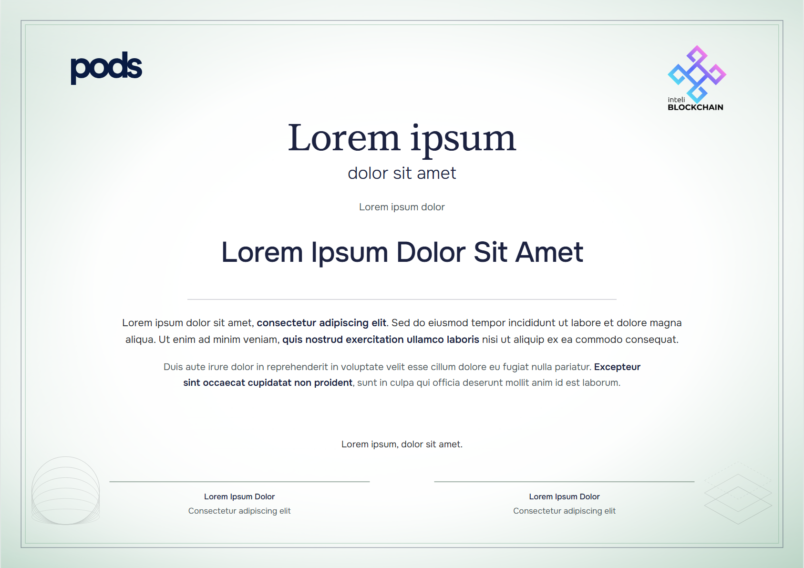
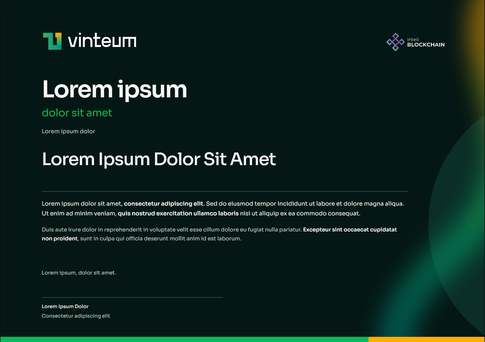
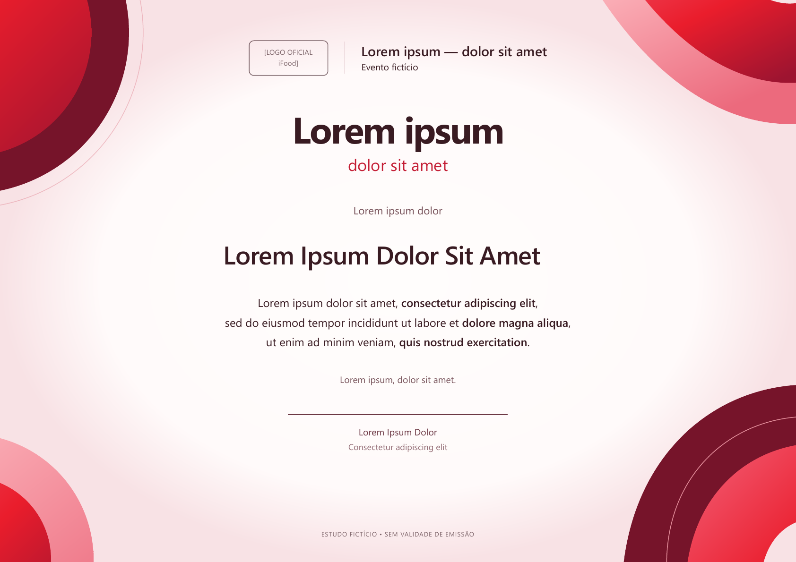

# Certificados personalizados

Skill para Codex que transforma a identidade visual de uma empresa em um template de certificado próprio, por meio de pesquisa, referências, propostas em HTML e refinamento com o usuário.

O objetivo não é trocar o logo de um diploma pronto: é produzir certificados coerentes com cada marca e diferentes entre si. A abordagem foi consolidada a partir de dois projetos, PODS e Vinteum, documentados em [estudos de composição](#exemplos).

A skill reconhece três pontos de entrada: criar um template, revisar um existente e exportar um modelo aprovado. Cada etapa tem critérios de conclusão; revisões preservam decisões aprovadas e a entrega informa eventuais verificações pendentes. Assim, você pode retomar o trabalho sem repetir toda a pesquisa.

A pesquisa padrão incorpora as [preferências visuais registradas](references/preferencias-visuais.md) a partir dos modelos PODS e Vinteum: atmosfera, acabamento institucional e integração entre identidade, grafismos e texto. Esse é o gosto que originou a skill, não um padrão universal; um novo briefing pode direcioná-la para outra estética. Referências já rejeitadas também são registradas para evitar repetir a mesma seleção.

## O que ela faz

- Pesquisa manuais, logos, fontes e materiais oficiais, distinguindo regras documentadas de observações e decisões de design.
- Busca referências de certificados e composição, inclusive no Pinterest quando acessível.
- Apresenta direções visuais, incorpora escolhas e preserva os elementos aprovados durante ajustes pontuais.
- Cria a prévia em HTML/CSS e prepara o template para nomes e outros campos variáveis.
- Orienta a verificação e exportação em PDF/PNG, ou PPTX quando solicitado.

A skill é um conjunto de instruções e referências. Não é um aplicativo, renderizador ou gerador por linha de comando. Não exige Canva e não inclui APIs, credenciais, listas reais de participantes, fontes comerciais ou pacotes oficiais de marca.

## Instalação no Codex

Baixe ou clone este repositório e copie a pasta inteira para o diretório de skills, mantendo `SKILL.md` diretamente dentro de `certificados-personalizados`.

**Windows / PowerShell**, a partir da pasta que contém o clone:

```powershell
$skillRoot = if ($env:CODEX_HOME) { Join-Path $env:CODEX_HOME 'skills' } else { Join-Path $env:USERPROFILE '.codex/skills' }
$destination = Join-Path $skillRoot 'certificados-personalizados'
if (Test-Path -LiteralPath $destination) { throw 'A skill já existe. Revise antes de substituir.' }
New-Item -ItemType Directory -Force -Path $skillRoot | Out-Null
Copy-Item -LiteralPath './certificados-personalizados' -Destination $destination -Recurse
```

**macOS / Linux**, a partir da pasta que contém o clone:

```bash
skill_root="${CODEX_HOME:-$HOME/.codex}/skills"
mkdir -p "$skill_root"
test ! -e "$skill_root/certificados-personalizados" && cp -R ./certificados-personalizados "$skill_root/"
```

Abra uma nova conversa no Codex após instalar. Se a skill não aparecer, reinicie o aplicativo. Ela pode ser selecionada automaticamente pelo contexto ou chamada explicitamente com `$certificados-personalizados`.

## Como usar

### Começar um certificado

```text
Use $certificados-personalizados para criar um template de participação
para o evento [TÍTULO], baseado na identidade visual da [EMPRESA].
Pesquise o site [URL] e materiais oficiais. Mostre primeiro um painel visual
numerado de referências variadas e aguarde minha seleção. Depois cruze
minhas escolhas com a marca e apresente propostas em HTML A4 horizontal.
O nome será variável. Reserve um campo de assinatura de [NOME/CARGO].
Mantenha placeholders para informações ainda não confirmadas.
```

Informe os dados disponíveis: empresa/site, evento, data e local, modalidade, carga horária validada, instituições, signatários e formatos desejados. Não é necessário ter todos os dados para começar a direção visual.

### Refinar uma proposta

```text
Gostei da proposta 2. Mantenha a tipografia e o fundo, mova os logos para
os cantos superiores e reserve mais espaço para nomes longos.
```

```text
Quero mais identidade da empresa. Explore os símbolos e a composição
dos materiais oficiais, com uma direção diferente do certificado anterior.
```

### Aprovar e exportar

```text
Template aprovado. Teste nomes curtos e longos e entregue HTML, PDF e PNG.
Confira o PDF renderizado antes de entregar. Não faça upload externo.
```

Emissão por CSV, envio ao Drive e PPTX são pedidos posteriores opcionais. A skill não presume essas ações nem garante equivalência entre HTML e PowerPoint sem conferência.

## Ferramentas e limites

Pesquisa requer acesso à web. Pinterest autenticado depende de uma ferramenta de navegador autorizada; uma conta conectada não garante que o runtime consiga acessá-la. A prévia exige navegador, e PDF/PNG exigem exportação/renderização disponíveis no ambiente. Codex deve usar as skills especializadas de PDF, apresentações e design quando disponíveis e pertinentes.

As fontes e logos são obtidos por projeto, observando origem, licença e permissões. Se um recurso não puder ser usado, a skill orienta uma substituição declarada ou um espaço identificado. O certificado não inventa assinaturas, autenticação, carga horária ou garantia de aproveitamento acadêmico.

## Exemplos

Os textos dos certificados publicados abaixo e dos respectivos arquivos de demonstração foram substituídos por **lorem ipsum**. Logos, composição e tipografia foram preservados. Os avisos de estudo fictício permanecem visíveis; o conteúdo dos eventos é descrito apenas na documentação do processo.

### Referências de qualidade aprovadas: PODS e Vinteum



[PODS — relações visuais e processo](assets/exemplos/pods/decisoes.md): halo verde, contorno fino, centro iluminado e equilíbrio entre logos e grafismos inferiores.



[Vinteum — relações visuais e processo](assets/exemplos/vinteum/decisoes.md): fundo petróleo, luz curva, geometria em grande escala e hierarquia tipográfica articulada pela cor.

As imagens mostram a composição dos modelos aprovados com texto de demonstração, sem destinatários reais. O objetivo é compreender a composição, não reproduzir esses layouts para todas as marcas. Recursos e marcas de terceiros conservam seus respectivos direitos.

### Teste com seleção de referências: iFood (evento fictício)



[HTML](assets/exemplos/ifood/certificado-ifood-template.html) · [PDF](assets/exemplos/ifood/certificado-ifood-template.pdf) · [Processo, escolha e limitações](assets/exemplos/ifood/decisoes.md)

O usuário selecionou referências de volume e geometria periférica e, entre duas propostas, preferiu a clara centralizada por ter “mais cara de certificado”. Este teste percorreu a seleção de referências, a composição e a escolha estética. Os arquivos públicos usam lorem ipsum e mantêm o campo do logo pendente; Segoe UI é uma substituição declarada. A aprovação da composição não significa aprovação oficial da marca.

### Teste histórico: Google (evento fictício)

[Abrir HTML-fonte](assets/exemplos/google/certificado-google.html) · [Baixar PDF](assets/exemplos/google/certificado-google.pdf) · [Pesquisa, decisões e teste](assets/exemplos/google/decisoes.md)

Este exemplo foi criado por um subagente sem o histórico dos projetos anteriores, usando a versão inicial da skill e o prompt então documentado. Foram apresentadas duas propostas; o usuário escolheu **Editorial aberto**, que passou pela exportação e verificação. Na avaliação posterior, considerou Google, OpenAI e Anthropic abaixo da personalidade visual alcançada por PODS e Vinteum. Esse teste demonstrou o fluxo técnico, mas não validou o padrão estético desejado. Ele permanece como histórico, não como modelo de qualidade recomendado.

O HTML abre localmente com os assets da pasta, sem servidor. No GitHub, baixe a pasta ou clone o repositório: a página de código não executa o HTML. A versão pública usa lorem ipsum e está identificada como estudo fictício, sem vínculo ou endosso da Google e sem validade de certificado.

A revisão da skill passou a pedir seleção de referências antes da composição, comparação visual com os modelos aprovados e avaliação estética separada das verificações técnicas. Isso ainda precisa ser validado em um novo projeto completo. Marcas citadas pertencem aos respectivos titulares; este projeto não declara vínculo oficial com elas.

## Estrutura

`SKILL.md` contém o fluxo principal; `references/` aprofunda pesquisa, composição e verificação; `assets/exemplos/` reúne os dois estudos; `agents/openai.yaml` define o nome e o prompt no Codex.

Para validar a estrutura com a ferramenta do skill-creator instalada:

```text
python <caminho-do-skill-creator>/scripts/quick_validate.py <caminho-da-skill>
```

O validador verifica a estrutura, não a qualidade estética. Esta depende de pesquisa, aprovação e inspeção das saídas.
