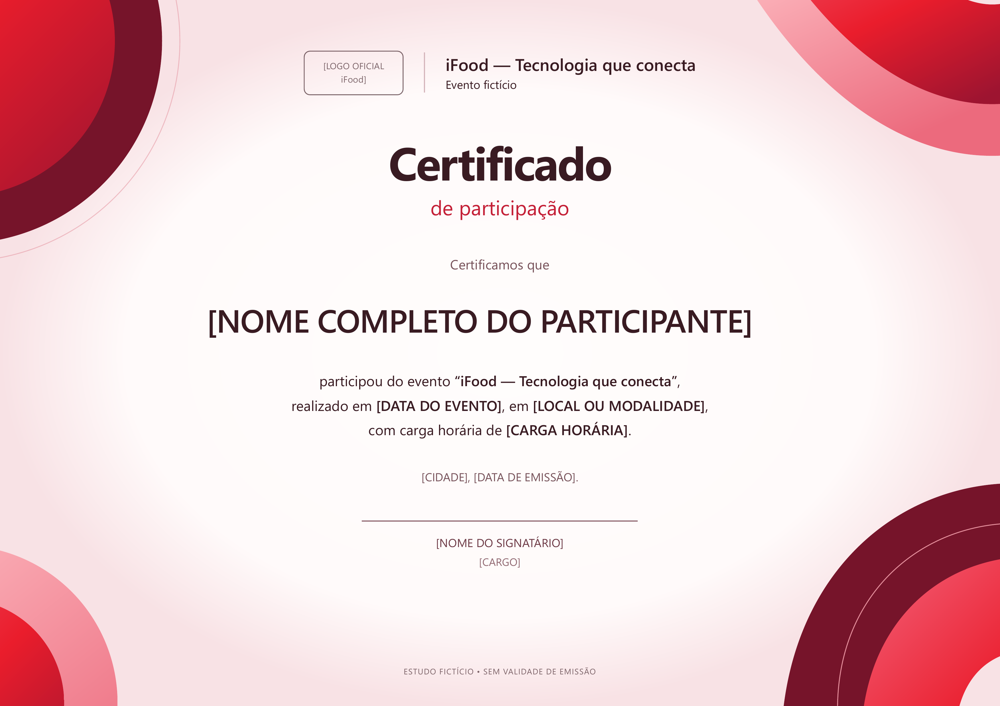

# iFood — Tecnologia que conecta

Evento fictício para testar a skill. O exemplo não tem validade de emissão nem vínculo com o iFood. Datas, horas, local, signatário e logo são placeholders; não foram confirmados ou inventados.

## Processo e escolha

Um subagente sem o histórico do chat usou a skill instalada e o prompt do README. Primeiro apresentou referências visuais; o usuário escolheu as de fundo escuro com volume e de geometria periférica. O subagente cruzou esses princípios com materiais acessíveis da marca e apresentou duas propostas: escura à esquerda e clara centralizada. O usuário preferiu a segunda: “o segundo está com mais cara de certificado”.

O exemplo escolhido tem núcleo claro, declaração e assinatura centralizadas, camadas curvas nos cantos e contraste entre vermelho, rosa e vinho. A geometria periférica cria um campo para o texto; o nome mantém destaque sem o evento assumir o papel de cartaz.

Essa escolha acrescenta evidência de gosto ao processo. Não impõe fundo claro ou centralização a outras marcas: o Vinteum escuro à esquerda continua sendo referência aprovada.

## Evidência e interpretação

O site [institucional do iFood](https://institucional.ifood.com.br/) e PDFs oficiais tiveram leitura direta limitada por HTTP 403. Materiais do [iFood Move na Comunidade iFood](https://comunidade.ifood.com.br/t/maior-evento-pra-restaurantes-da-america-latina/144258) e do [São Paulo Expo](https://www.saopauloexpo.com.br/pt/evento-spe/ifood-move/) apoiaram a observação de vermelho, branco, preto e peso tipográfico. A identidade de Move não foi aplicada como se pertencesse ao evento fictício.

Foram localizados relatórios oficiais com descrição visual indexada, incluindo [relatório de transparência](https://institucional.ifood.com.br/wp-content/uploads/2025/04/Ifood_Relatorio-Transparencia-1T25_PI_PT_V1-1.pdf) e [relatório 2023–2025](https://institucional.ifood.com.br/wp-content/uploads/2025/09/iFood_RS23-25_POR_VF-1.pdf). A pesquisa não confirmou um manual vigente. Curvas e cores são uma interpretação autoral do repertório observado; os códigos escolhidos não são apresentados como paleta normativa.

O logo segue como campo identificado. Segoe UI é uma substituição declarada; depende da disponibilidade do sistema e pode cair em Arial ou sans-serif. Não há fonte comercial redistribuída. Os grafismos são SVG autorais, não assets oficiais.

## Arquivos e verificação

- `certificado-ifood-template.html`: fonte autossuficiente com CSS e SVG, campos editáveis no navegador. Alterações locais não são salvas automaticamente no arquivo; salve o fonte para persistência.
- `certificado-ifood-template.pdf`: exportação do modelo com placeholders.
- `certificado-ifood-template.png`: prévia renderizada do PDF.

O subagente testou nome curto e nome longo com acentos, contenção na área disponível, ausência de colisão com o corpo e assinatura dentro da folha. O HTML também foi conferido em viewport de 390 px. O resultado é um template fictício selecionado para composição, com identidade ainda incompleta por falta do logo; não é um certificado oficial do iFood.
