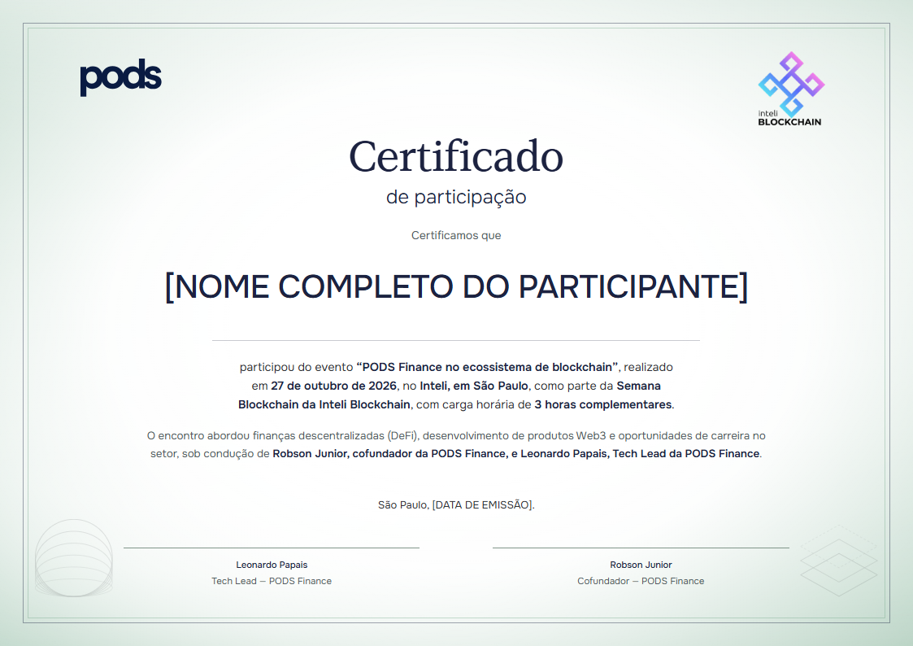

# PODS: delicadeza e composição central

Estudo retrospectivo de um certificado desenvolvido em colaboração. Não é manual oficial nem autorização de uso da marca.

Observe a integração: o halo verde cria profundidade e conduz o olhar ao centro, o contorno fino delimita a folha sem competir com o nome, e os grafismos inferiores equilibram os logos superiores. O título serifado introduz solenidade; o corpo e o nome sem serifa mantêm clareza contemporânea. A área central não é apenas espaço vazio: é um campo iluminado construído pela periferia mais densa.

A composição aprovada usou fundo claro com atmosfera verde suave, texto azul escuro, título serifado contrastando com corpo sem serifa e conteúdo centralizado. Logos em cantos superiores opostos equilibravam as instituições. Grafismos discretos nos cantos inferiores deixavam o centro disponível para o nome. Dois campos de assinatura estruturavam a base.

O refinamento passou por mover logos aos cantos, retirar seus fundos, deslocar grafismos para baixo e centralizar os textos. Cada pedido foi incorporado preservando a composição já aprovada. Uma variante de organização manteve o design e alterou somente conteúdo e horas confirmadas.

Lição reutilizável: equilíbrio institucional e identidade podem surgir de contraste tipográfico, espaço e grafismos sutis. Não reutilizar signatários, horas ou destinatários deste caso em outros eventos.
