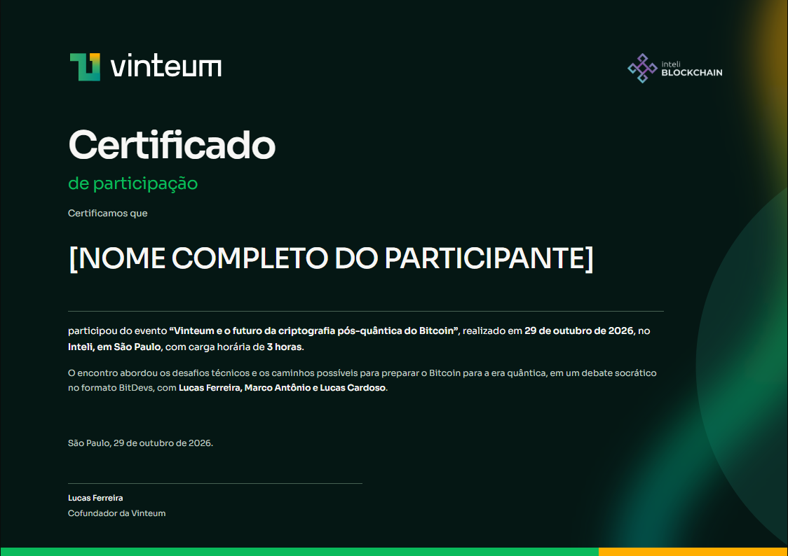

# Vinteum: composição editorial escura

Estudo retrospectivo de um certificado desenvolvido em colaboração. Consulte o manual atual antes de usar os recursos da marca.

Observe a integração: a luz curva na borda dá profundidade ao fundo petróleo e contrabalança a massa textual à esquerda. A geometria parcialmente fora da folha amplia a escala da peça. O verde do subtítulo conversa com o arco e a faixa inferior; a tipografia e o contraste sustentam o nome sem exigir uma moldura tradicional. Copiar só o alinhamento à esquerda perderia essa relação de forças.

A pesquisa encontrou o [site oficial](https://www.vinteum.org/) e um [brandkit público](https://www.vinteum.org/vinteum-brandkit.pdf). O manual consultado orientou Sora, a família de cores verde/amarelo/petróleo e o repertório de energia, arcos e orbes. Verifique disponibilidade e vigência ao reutilizar as fontes.

O usuário escolheu tema escuro. O certificado adotou fundo petróleo, texto claro, alinhamento à esquerda e hierarquia editorial sem moldura de diploma. Um arco luminoso autoral e um círculo parcialmente fora da folha interpretavam o repertório da marca. Uma faixa inferior verde/amarela fechava a composição. Havia um único campo de assinatura.

Os grafismos foram interpretações próprias, não assets oficiais. O resultado diferiu do PODS em estrutura, tipografia, alinhamento e atmosfera, preservando a função do certificado.

Lição reutilizável: pesquisar a segunda empresa de novo e permitir que a evidência mude o layout. A existência de um certificado anterior não obriga a segunda marca a caber nele.
